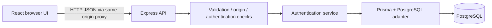

# Architecture

The backend is one independently runnable service. No extra distributed services are needed for this scope. React is a supporting client, not the source of authorization decisions.

## Actual files
- backend/src/config.ts: validates environment at startup.
- backend/src/db.ts: creates Prisma with the PostgreSQL driver adapter.
- backend/src/auth.ts: password verification, JWTs, registration, and refresh-session transactions.
- backend/src/app.ts: middleware, HTTP contracts, authorization, and errors.
- backend/src/server.ts: database startup, listener, and graceful shutdown.
- backend/src/provision-admin.ts: development-only account provisioning.
- frontend/src/api.ts: memory-only access token, credentialed fetch, single-flight refresh.
- frontend/src/main.tsx: registration, login, overview, profile, administration, and logout.

Keep this small structure until a feature needs extraction. Folders from the initial conceptual design were removed rather than retained empty.

## Login data flow
1. Browser submits credentials with a trusted Origin and custom request header.
2. Express checks origin, rate limit, JSON size, and Zod validation.
3. Auth service finds the normalized email and verifies Argon2id hash (dummy verification for unknown accounts).
4. A database transaction creates a hashed refresh session and audit record.
5. API sends a 10-minute JWT in JSON and a refresh credential in an HttpOnly cookie.
6. React keeps the JWT only in memory and sends it as Bearer authorization.
7. Protected API routes verify signature/claims and load the current database role.

## Refresh
An atomic conditional update consumes each refresh token once. The same transaction creates its replacement. Reusing a consumed token revokes its family and commits that revocation before responding 401. Concurrent refresh attempts cause a conservative family logout. Families have an absolute seven-day lifetime from login.
