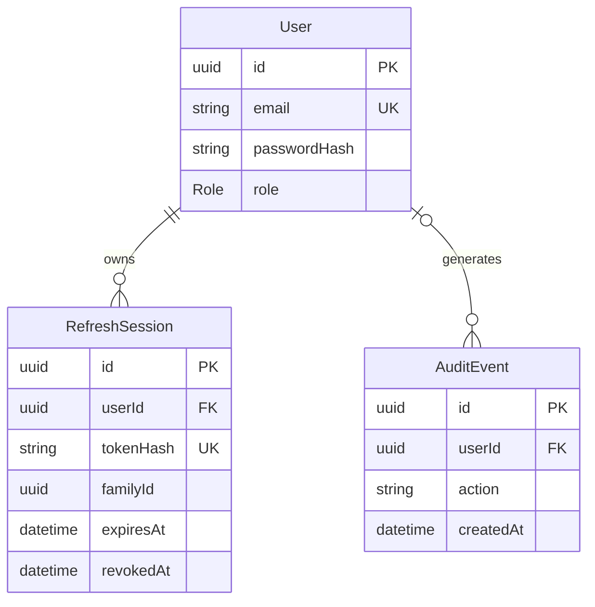

# Relational model

See backend/prisma/schema.prisma and its SQL migration. Email is trimmed and lowercased before insertion; the unique database constraint also protects concurrent registrations. Public input cannot set the USER/ADMIN enum. The two fixed roles do not require a configurable role table.

User deletion cascades sessions and sets audit userId to null. Indexes support user-session lookup, family revocation, and audit chronology. Refresh credentials are random 48-byte values; only SHA-256 hashes are stored. Passwords use Argon2id. Audit records hold action names and IDs, not credential material.

Replay detection retains revoked session history. A production retention policy/job is a documented next improvement; pruning must preserve replay history for active families.
